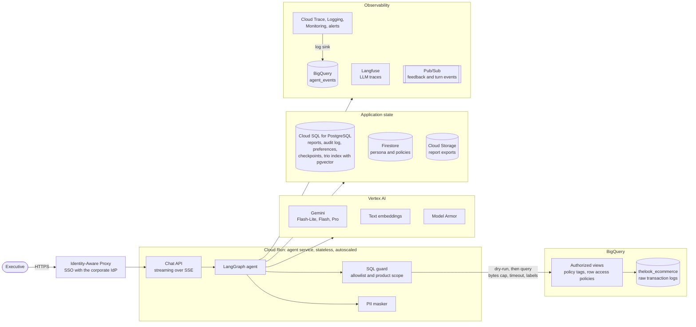
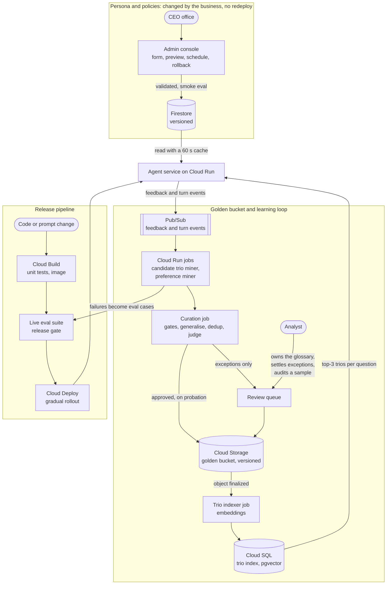
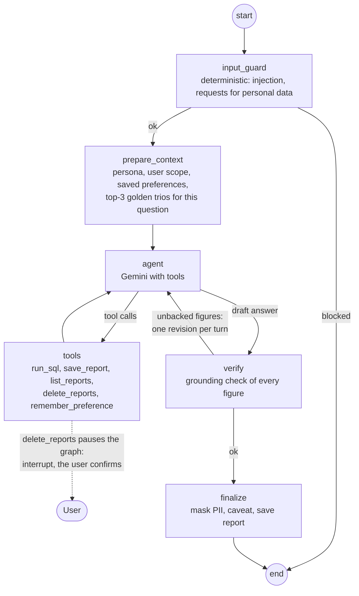
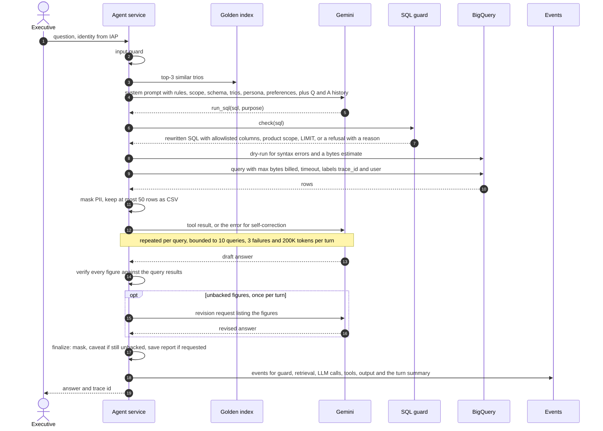
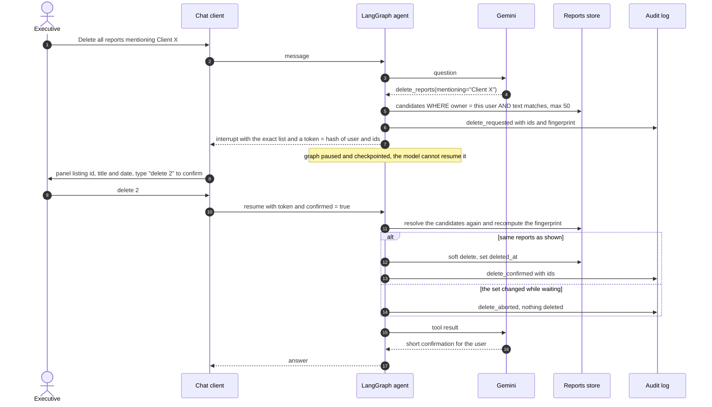
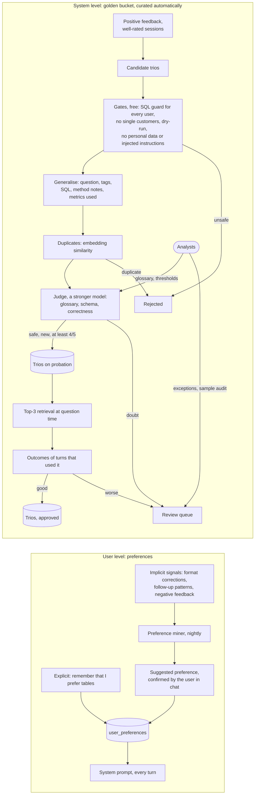

# High-Level Design — Retail Data Analysis Chat Assistant

This document describes the production architecture: which services we use, how the components talk to
each other, and where data is stored and how it is handled. The working prototype in this repository
implements the same agent with local stand-ins for the managed services (SQLite, YAML files, a CLI).
The last section maps each prototype stand-in to its production service. The reasoning behind each
choice, the per-requirement design and the error handling are in [TECHNICAL.md](TECHNICAL.md).

**Contents**
1. [Goals and principles](#1-goals-and-principles)
2. [Architecture](#2-architecture)
3. [The agent](#3-the-agent)
4. [Flows](#4-flows): question → answer · confirmed delete · learning loop
5. [Data: where it lives and how it is handled](#5-data-where-it-lives-and-how-it-is-handled)
6. [Security architecture](#6-security-architecture)
7. [Deployment, scaling and cost](#7-deployment-scaling-and-cost)
8. [Prototype → production mapping](#8-prototype--production-mapping)

---

## 1. Goals and principles

**Users.** Non-technical executives. They ask questions in plain language, discuss the answers, and ask
for reports with action items. Each manager may analyse only the brands they are responsible for; the
CEO sees everything.

**Principles that shape the design**

| Principle | Consequence |
|---|---|
| **Security is enforced in code at the data-access layer, never only in the prompt.** | The LLM writes SQL, but a deterministic guard parses and rewrites every query before BigQuery sees it. In production, BigQuery's own column- and row-level security sits behind the guard as well. A model can be talked into anything; the guard and the database cannot. |
| **Deterministic controls around a non-deterministic model.** | Input screening, the SQL guard, PII masking, the grounding check and the human confirmation for deletes are graph nodes and code paths, not prompt instructions. |
| **Every number must come from a query.** | Analysts reuse the golden examples. A grounding check verifies every figure in an answer against the conversation's query results and asks the model for one revision when figures are unbacked. |
| **Business-owned configuration.** | Tone, product scopes, the PII policy and the golden examples are data, not code. They change without a redeploy. |
| **Graceful degradation, bounded cost.** | Every dependency has a timeout, a retry budget, a fallback or a circuit breaker. Every turn has a budget for queries, failures, tokens and steps. The user always gets an answer, even if that answer explains what failed. |
| **Everything is traceable.** | Every turn has a `trace_id` that follows it through the logs, the LLM calls, BigQuery job labels and the audit trail. |

---

## 2. Architecture

### 2.1 Runtime: answering a question

### 2.2 Asynchronous paths: configuration, golden bucket, learning loop, releases

**Building blocks**

| Block | Service | Why this one |
|---|---|---|
| Identity | **Identity-Aware Proxy** with the corporate IdP (Identity Platform for external IdPs) | SSO with no auth code in the agent. IAP passes a signed identity header, and the agent maps that identity to a product scope. A user's identity is never taken from the conversation. |
| Agent service | **Cloud Run** (Python, LangGraph, FastAPI) | Stateless containers that autoscale, scale to zero for a small executive audience, and support long streaming responses. State lives in Postgres, so any instance can resume any conversation, including one paused for a delete confirmation. |
| LLM | **Gemini on Vertex AI** | Same model family as the prototype, with enterprise terms: customer data is not used for training, there are regional endpoints, VPC Service Controls, IAM instead of API keys, and provisioned throughput for predictable latency. A router sends simple questions to Flash-Lite and multi-step analyses and reports to Flash or Pro (see [TECHNICAL.md §2.2](TECHNICAL.md#22-llm-models)). |
| Prompt and response screening | **Model Armor** | A managed classifier for prompt injection and jailbreaks, on top of the deterministic input guard (which is free and instant but can only match patterns). |
| Data | **BigQuery**: the raw dataset is exposed only through **authorized views** | The views expose only allowlisted columns. **Policy tags** (column-level security) protect the PII columns, and **row access policies** apply each user's product scope. This is the same contract the SQL guard enforces, so a bug in either layer is caught by the other. |
| Application database | **Cloud SQL for PostgreSQL** | Holds the reports library (with full-text search), the audit log, user preferences, LangGraph checkpoints (`PostgresSaver`) and the golden-trio index (`pgvector`). One managed relational store with transactions is enough at this scale: hundreds of users and thousands of trios. Vertex AI Vector Search becomes worthwhile at around 10⁵ or more trios. |
| Golden bucket | **Cloud Storage** (versioned) | The source of truth for the trios, as YAML files owned by analysts. An object-finalize event triggers the indexer job, which validates and embeds each trio. |
| Persona and policies | **Firestore**, edited through a small admin console | Versioned documents that business owners edit without developers. The agent reads them with a short cache (60 s), so changes apply without a redeploy. Every change is validated and audited, and can be rolled back. |
| Learning loop | **Pub/Sub** with **Cloud Run jobs** | Feedback and turn events are processed asynchronously: candidate trios, preference suggestions and regression cases are produced, and humans review them before anything changes the agent's behaviour. |
| Observability | **OpenTelemetry** to **Cloud Trace, Logging and Monitoring**, a **BigQuery** log sink, and **Langfuse** | Spans and metrics give alerting; the BigQuery sink gives SQL analytics over all turns; Langfuse gives LLM-specific deep dives (prompt, tool calls, tokens) and stores eval datasets. |
| Secrets and perimeter | **Secret Manager**, **VPC Service Controls**, private IP for Cloud SQL | No keys in code or images. Data cannot be exfiltrated from BigQuery, Vertex AI or Cloud Storage outside the perimeter. |
| Output DLP | **Sensitive Data Protection** | Inspects the final answers for names and postal codes, which regexes cannot reliably detect, as the last layer behind the column allowlist and the masker. |

**Communication between components.**
- The client talks to the Chat API over HTTPS. Responses stream as Server-Sent Events, so the user sees
  progress lines such as "running query 2: revenue by month" and then the answer.
- Inside the service, calls to Gemini, BigQuery, Postgres and Firestore are synchronous, with timeouts.
- Learning-loop work is asynchronous over Pub/Sub, and nothing in it is on the user's critical path.
- Service-to-service authentication uses each component's service account under IAM. No API keys are
  used in production.

---

## 3. The agent

The agent is a LangGraph state machine. The prototype and production run the same graph; only the
stores behind it change.

| Node | What it does | Cost |
|---|---|---|
| `input_guard` | Normalises the text (Unicode NFKC, strips zero-width characters) and blocks prompt injection and requests for personal data with a helpful reply. Resets all per-turn state. | free, deterministic |
| `prepare_context` | Retrieves the top-3 golden trios for the question (embeddings, with BM25 as fallback). Builds the system prompt from the fixed rules, the user's scope, the schema (generated from the allowlist, so PII columns are never even named), the trios, the persona and the saved preferences. | 1 embedding call |
| `agent` | Calls Gemini through a fallback chain of models, each with a rate limiter and a circuit breaker. Enforces the per-turn token budget. | 1 LLM call |
| `tools` | `run_sql` = budget check → SQL guard → BigQuery (dry-run, then execute) → PII masker → at most 50 rows as CSV. The report and preference tools always filter by the session's owner. | 1 query |
| `verify` | Checks every significant figure in the draft against the numbers in the conversation's query results, including their sums, differences and column totals. If some are unbacked, it removes the draft and asks the model for **one** revision. | 0, or 1 extra LLM call when triggered |
| `finalize` | Masks PII in the answer, adds a caveat if figures are still unbacked, and saves the report if one was requested. A degraded turn is never saved. | free |

Each executive message is one **turn**, with its own `trace_id`. The history sent to the model contains
previous turns as question and answer only, while the current turn is sent in full. This keeps requests
small without losing the conversation.

---

## 4. Flows

### 4.1 Question → answer

Self-correction happens in steps 5–12. A failed, refused or empty query is not an exception: it comes
back to the model as a tool result that explains what went wrong. Examples are "`email` is personal data,
describe customers by age, state…", "Unrecognized name: categry", and "no rows: check the filter values
with SELECT DISTINCT". The model then fixes its query. The budgets are enforced in code, so a confused
model cannot loop or run up costs.

### 4.2 Confirmed delete (high-stakes operation)

How this keeps the UX intact:
- The conversation continues whatever the user answers.
- Pressing Enter or answering "no" cancels.
- A vague "yes" is asked again, once, with the exact phrase to type.
- Any other text cancels the delete and is then handled as the user's next request.
- The confirmation is collected by the client, outside the model, and is bound to the exact set of
  reports that was shown.

### 4.3 Learning loop

**Users confirm their own preferences.** Nothing about a user's answers changes silently.

**Golden examples are curated automatically, and people own the rules, not each example.** As
OpsFleet pointed out, an approval flow in which an analyst reviews every candidate does not scale. In
this design analysts maintain:
- a short **metric glossary**: net revenue, return rate, churn…;
- the thresholds;
- a review queue that receives only the **exceptions**: a metric the glossary does not define, a
  variant of an existing trio, a mid score, a model outage;
- a **sample audit** of automatic approvals, which tells how precise the judge is and when to tighten
  the thresholds.

Their workload then grows with the number of exceptions and the size of the sample, not with the
volume of candidates.

**An approved trio starts on probation.** It is retrieved like any other, and the outcomes of the turns
that used it are tracked: feedback, grounding revisions, SQL errors, rephrased questions. It is then
promoted, or sent back to review, automatically.

**Defences against poisoning**, needed because approval is automatic:
- trios are built only from SQL the guard accepts for *every* user;
- the text is rewritten by the generaliser and screened for injected instructions;
- each user has a cap on automatic approvals;
- in production, automatic approval also requires similar questions endorsed by several users;
- prompt, model and policy changes still pass the eval suite before release.

---

## 5. Data: where it lives and how it is handled

| Data | Production store | Prototype | Personal data? | Handling |
|---|---|---|---|---|
| Raw transaction logs | BigQuery `thelook_ecommerce`, read-only, reached only through authorized views | public dataset via the SQL guard | yes, in `users` (8 columns) | PII columns cannot be selected: they are not in the allowlist, they are protected by policy tags, and the guard refuses them. Rows are filtered by the user's product scope. |
| Query results | memory of the running turn; masked copy in the trace | same | masked | At most 50 rows reach the LLM. Rows are aggregated in SQL, never pulled raw. |
| Conversation checkpoints | Cloud SQL (`PostgresSaver`) | in memory (`InMemorySaver`) | masked results only | Kept 30 days. They allow resuming after a restart, including a pending delete confirmation. |
| Saved reports | Cloud SQL (full-text index); Markdown/PDF export in Cloud Storage | SQLite with FTS5; `reports/*.md` | masked before saving | Visible and deletable only by the owner. Deletes are soft (`deleted_at`) and purged after 30 days, which also gives an undo window. |
| Audit log | Cloud SQL, append-only, exported to BigQuery | SQLite `audit_log` | report ids and user ids only | Records each delete request, confirmation, cancellation and abort, plus each report saved. Kept at least 1 year. |
| User preferences | Cloud SQL | SQLite `user_preferences` | no | Kept until the user clears them (`/prefs clear`). Shown in the prompt every turn. |
| Events and traces | Cloud Logging → BigQuery sink; Langfuse | SQLite `events` + `logs/agent.jsonl` | masked before writing | Detailed traces kept 30 days; aggregated metrics kept longer. |
| Golden trios | Cloud Storage (versioned) + pgvector index | `golden/trios/*.yaml` + embedding cache in `.cache/` | none: method notes, no customer data, no current numbers | Curated automatically (approved trios start on probation); validated against the SQL guard for every scope before indexing. |
| Curation queue: candidates, review, rejected | Cloud Storage + review UI | `golden/candidates/`, `golden/review/`, `golden/rejected/` + `logs/curation.jsonl` | candidates and rejected files keep the original (masked) answer, which can describe pseudonymous customers | Candidates leave the queue in one run. Rejected files: short retention, restricted access. |
| Persona and policies | Firestore (versioned) + admin console | `config/*.yaml`, re-read every turn | no | Validated on save; the last valid version is kept if an edit is invalid. Every change is audited. |
| Secrets | Secret Manager; IAM for Google APIs | `.env` (git-ignored) | — | Never logged. Vertex AI and BigQuery use service accounts, not keys. |

What reaches the LLM:
- the schema of non-PII columns;
- masked, aggregated query results;
- the conversation.

Raw rows with personal data never leave BigQuery.

---

## 6. Security architecture

Defence in depth, from the user's message to the answer. Each layer would be enough for the common
case; together they make a single failure harmless.

| # | Layer | Stops | Where |
|---|---|---|---|
| 1 | Identity from SSO, scope from the entitlement mapping | impersonating another user, or claiming a scope through the chat ("my manager approved access to every brand…") | IAP → agent session (prototype: `--user`) |
| 2 | Input guard (deterministic) + Model Armor | prompt injection, jailbreaks, direct requests for personal data | `input_guard` node |
| 3 | Fixed rules in the system prompt, which the persona cannot override | off-topic requests, revealing instructions, data values treated as instructions | prompt assembly |
| 4 | Schema generated from the allowlist | the model never learns that PII columns exist | prompt assembly |
| 5 | **SQL guard**: parse, allow one SELECT only, allowlist tables, refuse PII columns and risky functions, rewrite every table into an allowlisted and scoped subquery, cap rows | data modification, other datasets, PII columns, `SESSION_USER()`, data outside the user's scope | `run_sql` |
| 6 | **BigQuery**: dry-run re-check of the statement type and tables; authorized views, policy tags and row access policies; bytes cap and timeout | anything the guard missed; cost abuse | data layer |
| 7 | PII masker on tool results and on the final answer, plus Sensitive Data Protection | personal data that slipped through in values or in the model's text | `run_sql`, `finalize` |
| 8 | Grounding check | invented figures presented as facts | `verify`, `finalize` |
| 9 | Human confirmation bound to the exact ids, owner filter, soft delete, audit log | destructive actions the user did not intend, or deleting another user's reports | `delete_reports` |
| 10 | Masked traces, audit trail, alerts on guard refusals per user | undetected abuse | observability |

---

## 7. Deployment, scaling and cost

- **Environments**: dev, staging and prod in separate projects, each inside VPC Service Controls.
  Infrastructure is defined in Terraform.
- **CI/CD**: Cloud Build runs the offline tests on every commit and builds the image. On staging it runs
  the live eval suite as a **release gate**: 100% on safety and oversight cases, at least 90% overall,
  three runs to absorb model variance, and a comparison with the previous release. Only then does Cloud
  Deploy promote to production with a gradual rollout.
- **Changes without a deploy**: persona, scopes, the PII policy and the golden trios are data. Each edit
  is validated (schema, and the SQL guard for trios). A quick smoke eval runs before the new version is
  activated, and the previous version stays one click away.
- **Scaling**: Cloud Run is stateless and keeps all state in Postgres. Rate limits for Gemini are shared
  across instances through Memorystore (Redis); the prototype limits per process. BigQuery scales on its
  own. A **BigQuery reservation** or per-user custom quotas cap the analytics spend.
- **Latency**: streaming progress keeps the wait visible. Measured in the prototype: a one-query answer
  takes about 8 s (2 LLM calls); a report with 3 queries takes about 13 s; a blocked input takes 0 s.
  Production targets: p50 under 10 s, p95 under 30 s (alerted).
- **Cost control**:
  - schema and golden examples go in the prompt instead of tool round-trips;
  - previous turns are sent as question and answer only;
  - at most 50 result rows reach the LLM;
  - a dry-run (free) runs before every query, and `maximum_bytes_billed` applies to every job;
  - per-turn caps on queries, failures, tokens and graph steps;
  - at most one grounding revision per turn;
  - the input guard is deterministic instead of an LLM classifier;
  - circuit breakers instead of retry storms;
  - BigQuery query cache.

  BigQuery cost per query is visible per trace through the job labels. The prototype prints an estimated
  cost in `/stats`.

---

## 8. Prototype → production mapping

| Building block | Prototype (this repo) | Production |
|---|---|---|
| Client | CLI (Typer + Rich): `retail-agent chat --user <id>` | Web chat or Slack/Google Chat app on the same Chat API |
| Identity | `--user` selects a demo identity from `config/users.yaml` | IAP + corporate SSO; entitlement service → scope |
| Agent runtime | local process, LangGraph | Cloud Run service, same graph |
| LLM | Gemini via Google AI Studio (free tier): `gemini-3.5-flash-lite` → `3.1-flash-lite` → `3.6-flash` | Gemini on Vertex AI, with routing by question complexity |
| Checkpoints | `InMemorySaver` | `PostgresSaver` on Cloud SQL |
| Reports, audit, preferences, events | SQLite (`data/agent.db`) + `logs/agent.jsonl` | Cloud SQL + Cloud Logging → BigQuery + Langfuse |
| Golden bucket | `golden/trios/*.yaml`, Gemini embeddings cached on disk, BM25 fallback | Cloud Storage + indexer job + pgvector, hybrid retrieval |
| Candidate trios | `/good` writes `golden/candidates/*.yaml`; `retail-agent golden curate` approves (on probation), queues for review or rejects | Pub/Sub → candidate miner → curation job → trios on probation, review queue for exceptions |
| Persona, scopes, PII policy | `config/*.yaml`, re-read every turn | Firestore + admin console, versioned |
| SQL safety | SQL guard + runner checks | the same, plus authorized views, policy tags, row access policies |
| Output safety | regex/column masker | the same, plus Sensitive Data Protection and Model Armor |
| Rate limits, breakers | in process, per model | shared in Memorystore |
| Ops views | `retail-agent traces / trace / stats` | Cloud Monitoring dashboards and alerts, Langfuse, BigQuery |
| Evals | `retail-agent eval` (20 live cases) | the same suite as the CI release gate, plus sampled online judging |
